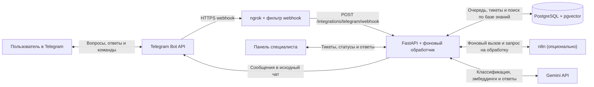

# AI Service Desk MVP

Текущий результат включает внутреннюю панель Support Agent/Admin: FastAPI, PostgreSQL/pgvector, тикеты и сообщения, импорт PDF/TXT/Markdown с Gemini embeddings, поиск по базе знаний, Gemini-классификацию, Telegram webhook с эскалацией и server-rendered панель для очереди и работы с тикетами.

## Архитектура



FastAPI сохраняет входящее сообщение в PostgreSQL и подтверждает приём Telegram. Фоновый обработчик вызывает n8n, если он настроен, и переходит на прямую обработку FastAPI при ошибке вызова. Публичный маршрут принимает только Telegram webhook с проверкой секрета. Панель в локальном демо доступна через localhost.

## Демо для портфолио

Запустите стек и HTTPS-туннель по инструкции ниже. Загрузите статью [«Принтер не печатает»](docs/knowledge/04-Принтер.md) в базу знаний, если она ещё не проиндексирована.

1. Спросите бота в личном чате: «Как отменить только моё зависшее задание печати?» Бот предложит открыть очередь печати и отменить своё задание. Под ответом появится источник `04-Принтер.md`.
2. Нажмите **«Нужен специалист»**. Бот пришлёт номер тикета. В карточке сохранятся исходный вопрос, причина передачи специалисту, ответ Gemini и источник.
3. Откройте тикет в [панели](http://localhost:8000/ui/tickets) под персональной учётной записью специалиста и нажмите **Take ticket**. Отправьте ответ из карточки и убедитесь, что он появился в том же чате.
4. Выберите статус **Closed**, внесите итог в поле **Resolution** и сохраните изменения. Отправьте боту `/tickets`. Рядом с номером обращения появится **«закрыто»**.

## Запуск

1. Скопируйте `.env.example` в `.env`, замените все токены/пароли и задайте случайный `SESSION_SIGNING_SECRET` (например, `python -c "import secrets; print(secrets.token_urlsafe(32))"`). Не публикуйте `.env`.
2. Укажите `GEMINI_API_KEY` из Google AI Studio. Модели по умолчанию заданы в `.env.example`. Для смены embedding-модели при той же размерности переиндексируйте базу знаний командой `docker compose exec api python -m scripts.reembed_knowledge`. Размерность `EMBEDDING_DIMENSIONS` на существующей базе должна соответствовать колонке PostgreSQL: её изменение требует миграции схемы и переиндексации.
3. Запустите API и PostgreSQL командой `docker compose up -d --build db api`. По умолчанию FastAPI обрабатывает обращения напрямую.
4. Compose применит Alembic-миграции до запуска API.
5. API и Swagger доступны на `http://localhost:8000` и `/docs`; панель — на `http://localhost:8000/ui/login` при локальной loopback-разработке.
6. Для использования n8n настройте [workflow](n8n/README.md) и активируйте его перед регистрацией webhook Telegram.

### Telegram на тестовом стенде

Остановите прежний туннель, если он уже использует тот же домен ngrok. Задайте в `.env` токен бота и секрет webhook. Создайте локальный файл `.env.telegram` с настройками:

```dotenv
NGROK_DOMAIN=your-domain.ngrok-free.dev
NGROK_AUTHTOKEN=your-ngrok-agent-token
TELEGRAM_ALERT_CHAT_ID=123456789
TELEGRAM_QUEUE_ALERT_COUNT=10
TELEGRAM_QUEUE_ALERT_AGE_SECONDS=120
```

Для приёма оповещений начните личный чат с этим ботом и укажите ID тестового чата. Запустите стек из корня репозитория:

```powershell
docker compose --env-file .env --env-file .env.telegram -f compose.yaml -f compose.telegram.yaml up -d --build
```

Для маршрута через n8n добавьте `--profile automation` перед `up` и настройте workflow по [инструкции n8n](n8n/README.md). Зарегистрируйте webhook на `https://<NGROK_DOMAIN>/integrations/telegram/webhook` через Telegram Bot API с `secret_token` со значением `TELEGRAM_WEBHOOK_SECRET` и типами обновлений `message` и `callback_query`.

Docker перезапускает контейнеры ngrok, прокси и мониторинга при сбое и запуске Docker Engine, если их не остановили вручную. Прокси пересылает только POST на маршрут webhook. Монитор примерно раз в минуту сверяет адрес в Telegram, проверяет публичный маршрут и считает необработанные сообщения в PostgreSQL. Оповещение приходит при недоступности webhook, ошибке проверки БД, достижении порога очереди или восстановлении. Статус оповещений хранится в памяти процесса: после перезапуска монитор может повторно сообщить о текущем сбое. Если Bot API недоступен, события остаются в логах контейнера `telegram-monitor`, а отправка повторяется, пока сохраняется обнаруженная проблема.

### Проверки webhook

Если настроен n8n, контейнерный монитор проверяет его webhook раз в цикл. Ответ HTTP 401 или 403 на запрос без токена означает, что маршрут зарегистрирован и защищён. Ошибка соединения или другой статус вызовет оповещение, даже если очередь обработалась напрямую через FastAPI. Проверка охватывает маршрут и проверку доступа, а выполнение workflow проверяется при обработке обращений.

Для проверки снаружи стенда добавьте в секреты репозитория GitHub Actions `STAGING_WEBHOOK_URL` с полным публичным HTTPS-адресом webhook. После появления workflow **External staging webhook** в основной ветке запустите пробный прогон вручную в Actions, затем задайте переменную репозитория `STAGING_WEBHOOK_MONITOR_ENABLED=true` для проверки примерно раз в 10 минут. Включите уведомления GitHub Actions о неудачных запусках по почте или в веб-интерфейсе. [Настройка уведомлений GitHub](https://docs.github.com/en/actions/concepts/workflows-and-actions/notifications-for-workflow-runs). Плановые запуски могут задерживаться, а GitHub отключает расписание в публичных репозиториях после 60 дней без активности. [Ограничения расписания](https://docs.github.com/en/actions/reference/workflows-and-actions/events-that-trigger-workflows#schedule).

### Ручной запуск туннеля

Для локальной демонстрации можно запустить прокси и ngrok в отдельных терминалах:

```powershell
python scripts/telegram_ingress.py
ngrok http http://127.0.0.1:18081 --inspect=false
```

Агент ngrok должен быть подключён к вашему аккаунту. Используйте выданный HTTPS-адрес с путём `/integrations/telegram/webhook` при регистрации бота и укажите типы обновлений `message` и `callback_query`. Локальный фильтр пересылает только POST на этот путь. Панель открывается на localhost. При регистрации передайте `secret_token` со значением `TELEGRAM_WEBHOOK_SECRET`.

Схема управляется Alembic; отдельный Compose service применяет миграции до старта API. В контейнере PostgreSQL с pgvector опубликован локально на `127.0.0.1:5433`, чтобы не конфликтовать с установленным в Windows PostgreSQL на порту `5432`.

## Проверки

- Проверено восстановление PostgreSQL из архива `pg_dump` через `pg_restore` в отдельном контейнере. Количество записей и контрольные суммы SHA‑256 совпали для тикетов, сообщений, статей и фрагментов базы знаний с эмбеддингами. Рабочая база использовалась только для чтения.
- Установите зависимости: `python -m venv .venv`, затем `.venv/Scripts/python -m pip install -r requirements.txt` (Windows) или `source .venv/bin/activate && pip install -r requirements.txt` (Linux/macOS).
- Запустите полный набор: `.venv/Scripts/python -m pytest -q -rs`.
- API integration tests используют отдельную PostgreSQL базу, указанную в `TEST_DATABASE_URL`; тесты создают и удаляют собственную случайную schema и никогда не очищают остальные схемы этой базы.
- Для Telegram/Gemini и миграций production-путь дополнительно требует живые внешние сервисы; unit tests не отправляют запросы наружу.

## API и доступ

[Контракт API и панели](docs/openapi.yaml) · [Архитектура](docs/ARCHITECTURE.md) · [Требования](docs/PRD.md)

Swagger: `http://localhost:8000/docs`. Пользовательские/агентские endpoints используют Bearer-токены из `USER_API_TOKENS`, `AGENT_API_TOKEN` и `ADMIN_API_TOKEN`; исключения — health checks, Telegram webhook (Telegram secret header) и внутренний process endpoint (отдельный `WORKFLOW_TOKEN`).

### Панель Agent/Admin

Откройте `/ui/login` и введите `AGENT_API_TOKEN`, `ADMIN_API_TOKEN` или персональный токен из `PANEL_AGENT_TOKENS`. Подписанная cookie содержит роль, CSRF-токен, срок действия (8 часов) и имя специалиста при персональном входе. Cookie имеет `HttpOnly`, `Secure`, `SameSite=Lax`; все формы, изменяющие данные, защищены CSRF. `SESSION_SIGNING_SECRET` обязателен: API не запустится без него. Для доступа через HTTP в локальной разработке используйте loopback `localhost`; при любом сетевом развертывании обязателен HTTPS и allowlist доверенной сети на ingress/firewall. Compose публикует API только на `127.0.0.1`; не выставляйте его напрямую в недоверенную сеть.

Панель ищет по номеру, теме и описанию во всей очереди. Фильтр статуса применяется до пагинации. На странице отображается до 25 тикетов. Agent/Admin могут просматривать историю, добавлять ответы и менять статус, приоритет и resolution. Только Admin может видеть и загружать документы базы знаний. Общие role-токены не дают персональной идентификации или атрибуции автора в аудите.

Ответ Agent/Admin из панели отправляется в исходный Telegram private-чат только для новых тикетов, у которых сохранён адрес чата из webhook. Ответы длиннее 4 000 символов для таких тикетов отклоняются до сохранения. Сначала сохраняется ответ, затем выполняется одна попытка отправки; панель показывает результат отдельно, автоматических повторов нет. Групповые чаты и старые тикеты без сохранённого адреса не уведомляются. Для этой функции требуется Alembic revision `0004_telegram_reply_notification`.

| Endpoint | Доступ/назначение |
|---|---|
| `GET /health/live`, `GET /health/ready` | доступность процесса и проверка соединения с БД (HTTP 503 при недоступности БД) |
| `POST, GET /api/v1/tickets` | создание тикета; список до 100 последних тикетов, фильтр `?status=` |
| `GET, PATCH /api/v1/tickets/{ticket_id}` | чтение тикета; изменение статуса, приоритета или resolution |
| `GET, POST /api/v1/tickets/{ticket_id}/messages` | чтение истории и добавление сообщения |
| `POST /api/v1/ai/analyze` | анализ текста |
| `GET, POST /api/v1/knowledge/documents` | список документов; загрузка PDF/TXT/Markdown (только Admin) |
| `GET /api/v1/analytics/overview` | сводка количества тикетов по статусу |
| `POST /integrations/telegram/webhook` | Telegram webhook, проверяется секретный заголовок |
| `POST /api/v1/internal/process-message` | внутренний вызов n8n с `WORKFLOW_TOKEN` |
| `/ui/login`, `/ui/logout` | панель Agent/Admin; формы используют защищённую сессию и CSRF |
| `GET /ui/tickets`, `GET /ui/tickets/{ticket_id}` | очередь и история тикета |
| `POST /ui/tickets/{ticket_id}/messages`, `/update` | ответ и изменение полей тикета |
| `POST /ui/tickets/{ticket_id}/claim` | взять тикет в работу под персональной учётной записью |
| `GET /ui/tickets/{ticket_id}/photos/{message_id}` | открыть прикреплённый к тикету Telegram-скриншот |
| `GET /ui/knowledge`, `POST /ui/knowledge/upload` | список/загрузка документов, только Admin |

Пользовательские операции требуют персональный Bearer-токен и соответствующий ему `X-Telegram-User-ID`; пользователь может читать/комментировать только принадлежащие этому ID тикеты. Agent/Admin имеют доступ к очереди, PATCH тикетов доступен Agent/Admin, загрузка документов — только Admin. AI analyze, список документов и аналитика доступны Agent/Admin. PATCH требует хотя бы одно известное поле; `status` и `priority` не могут быть `null`, неизвестные поля отклоняются. Разрешённые статусы: `open`, `in_progress`, `waiting_for_user`, `resolved`, `closed`.

Задайте `USER_API_TOKENS='{"123456789":"<случайный-персональный-токен>"}'` в `.env`. Ключ JSON — Telegram ID пользователя, значение — его уникальный случайный ASCII-токен. Прежний общий `USER_API_TOKEN` больше не используется. При пустой карте User API отключён. Доступ Agent/Admin использует общие токены ролей и рассчитан на доверенную сеть и HTTPS.

Для Telegram задайте `TELEGRAM_TOKEN` и отдельный случайный `TELEGRAM_WEBHOOK_SECRET`; зарегистрируйте webhook на публичный HTTPS URL `/integrations/telegram/webhook` с этим значением в `secret_token`. Запросы должны содержать `X-Telegram-Bot-Api-Secret-Token`. Не помещайте токен бота в код, workflow-файл или репозиторий. Malformed JSON/text updates возвращают `400`; webhook также принимает кнопки обратной связи и фото с подписью `/add НОМЕР` в личном чате. Остальные неподдерживаемые обновления подтверждаются и игнорируются. Текст ограничен 20 000 символами, исходящие ответы отправляются обычным текстом без parse mode и ограничены 4 000 символами. Новые сообщения дедуплицируются по ID чата и ID сообщения. Автоматический ответ отправляется в сохранённый личный чат. Перед вызовом Telegram приложение сохраняет статус unconfirmed. Подтверждение меняет статус на accepted. Повторная обработка пропускает отправку при обоих статусах. При таймауте или остановке процесса фактическая доставка может остаться неизвестной.

`N8N_WEBHOOK_URL` необязателен. Если он пуст, фоновый обработчик сразу запускает FastAPI напрямую. Если n8n настроен, прямая обработка запускается после ошибки соединения, таймаута или HTTP-ответа вне диапазона 2xx. Оба пути используют одну запись сообщения и переиспользуют сохранённый результат при повторе. Используйте разные случайные значения `N8N_INGRESS_TOKEN` и `WORKFLOW_TOKEN` и назначьте credentials согласно `n8n/README.md`. Webhook возвращает HTTP 200 после записи сообщения и времени обработки в PostgreSQL. При сбое фоновой обработки следующая попытка запланирована через 15 секунд. При остановке процесса незавершённая запись снова доступна через 5 минут.

## База знаний и передача специалисту

Стартовые статьи находятся в [docs/knowledge](docs/knowledge). В панели Admin откройте `/ui/knowledge` и загрузите каждый Markdown-файл отдельно. Убедитесь, что у каждого документа статус `indexed`. При загрузке приложение отправляет текст статей в Gemini API для построения эмбеддингов.

Для обычного запроса Gemini получает подходящие фрагменты проиндексированных документов и формирует ответ по ним. Бот добавляет названия источников. Если поиск не находит подходящих фрагментов, Gemini не может подтвердить решение, не уверен в классификации или недоступен, приложение создаёт тикет и сообщает его номер. Критические запросы и запросы, требующие участия специалиста, также переходят в очередь.

Статьи содержат общие инструкции. Перед загрузкой корпоративных инструкций уточните у владельца процесса, какие сведения можно передавать Gemini API.

## Retention

Retention составляет 365 дней. После миграции Alembic запустите ежедневное расписание на стороне оператора/хоста (scheduler не входит в Compose). Сначала выполняйте `docker compose exec api python -m scripts.cleanup_retention`: dry-run по умолчанию показывает счётчики и ничего не удаляет. Оператор должен проверить результат и только затем запустить `docker compose exec api python -m scripts.cleanup_retention --execute`. Команда удаляет закрытые тикеты с `closed_at` строго раньше cutoff и их сообщения, старые документы и audit logs, а также старые сообщения без тикета; открытые тикеты сохраняются. Для подробностей и ограничений см. [`docs/retention.md`](docs/retention.md).

## Тесты и ограничения

- Полный набор: `python -m pytest -q -rs`. Unit tests включают правила `TicketPatch`, обработку ошибки AI с эскалацией и базовые RAG/schema проверки.
- Панель: `python -m pytest -q tests/test_panel_auth.py tests/test_panel_routes.py` проверяет роли, cookie/CSRF, формы, проверку параметров поиска, локальные шаблоны/assets и Admin-only загрузку.
- API integration tests проверяют owner access и сортировку истории сообщений, RBAC, HTTP 503 при ошибке AI, повтор фоновой обработки Telegram, DB readiness при недоступности БД, malformed/non-text/повторные Telegram updates, а также retention cutoff, dry-run и удаление с сохранением открытых тикетов.
- Все PostgreSQL integration/retention tests используют `TEST_DATABASE_URL`, создают случайную отдельную schema и удаляют её после теста. Без `TEST_DATABASE_URL` они пропускаются с явной причиной в `pytest -rs`; тесты не должны использовать production URL.
- AI provider, n8n и Telegram вызовы в тестах подменяются; тесты не используют реальные пользовательские данные или реальные ключи и не отправляют запросы в эти сервисы.
- PDF поддерживает только извлекаемый текст, OCR сканов не реализован; загрузка ограничена 10 MB. Gemini API имеет квоты и условия обработки данных, проверьте их перед передачей пользовательских данных.
- Маршрутизация — стартовые правила в backend. Гарантированной очереди/outbox, assignment history, отдельного feedback workflow и административного процесса привязки Telegram identity пока нет.

## Диалог в Telegram и очередь специалистов

В личном чате отправьте /tickets, чтобы увидеть последние 10 обращений, или /add НОМЕР текст, чтобы дополнить своё обращение. Для скриншота отправьте фото с подписью /add НОМЕР и при необходимости добавьте пояснение. Скриншот открывается из карточки тикета. Под новыми ответами Gemini бот показывает кнопки «Помогло» и «Нужен специалист». Telegram webhook должен принимать типы message и callback_query.

Для персонального назначения укажите PANEL_AGENT_TOKENS в .env как JSON-объект с именами специалистов и отдельными токенами. После входа с персональным токеном специалист может взять тикет в работу и открыть My tickets. В общей очереди доступны фильтры Unassigned, Waiting for a reply и Unconfirmed automatic reply.
