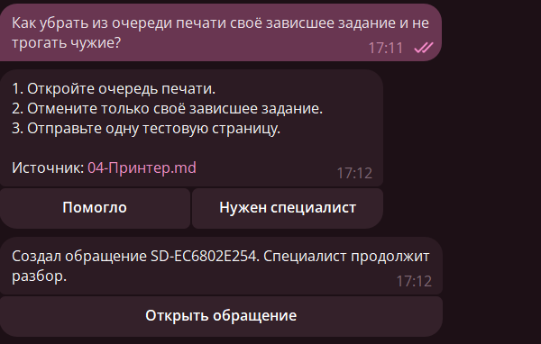
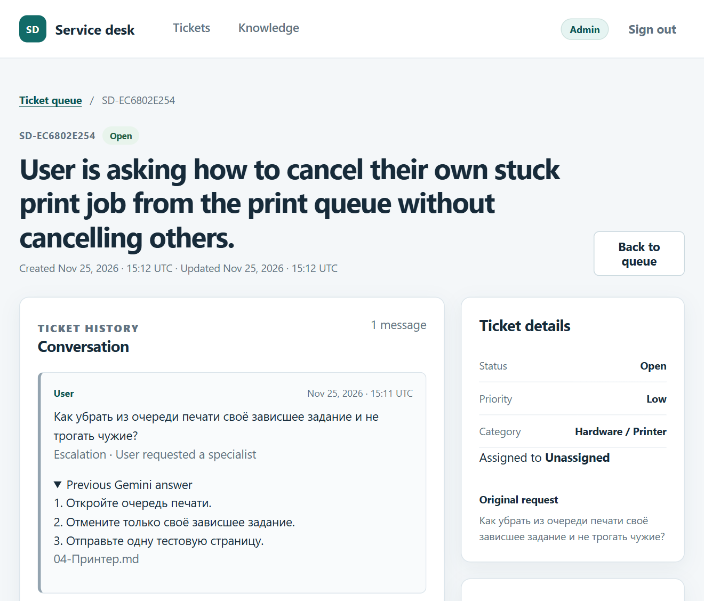
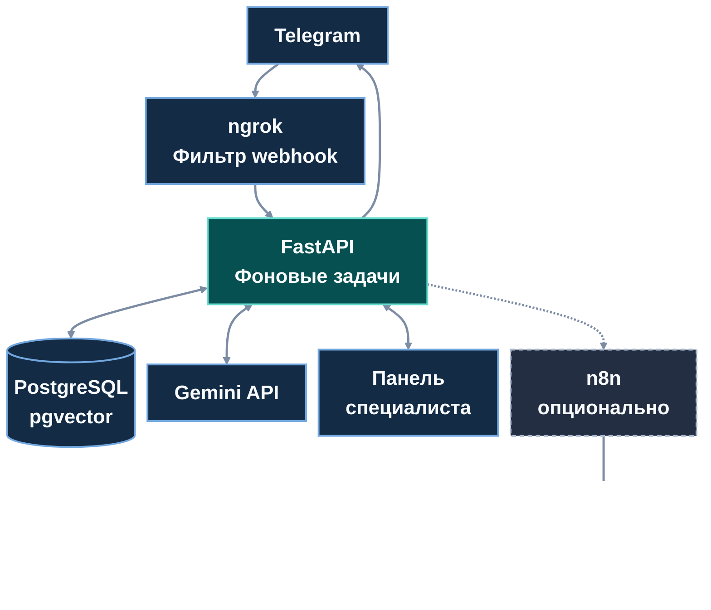

# AI Service Desk

**IT-поддержка в Telegram.** Бот отвечает по базе знаний и показывает источник. Если вопрос требует участия человека, бот создаёт тикет. Специалист может ответить из веб-панели прямо в исходный чат.

[Демо](#от-вопроса-до-тикета) · [Быстрый старт](#установка-с-нуля) · [Архитектура](#архитектура) · [Документация](#документация)

<a name="демо-для-портфолио"></a>

## От вопроса до тикета

### Ответ в Telegram

Пользователь спрашивает, как отменить только своё зависшее задание печати. Бот отвечает по статье [«Принтер не печатает»](docs/knowledge/04-Принтер.md) и показывает источник под ответом.

[](docs/demo/printer-telegram.png)

### Карточка у специалиста

Кнопка **«Нужен специалист»** создаёт тикет `SD-EC6802E254`. В панели видны исходный вопрос, причина передачи и предыдущий ответ со статьёй.

[](docs/demo/printer-ticket.png)

<details>
<summary>Повторить сценарий на своём стенде</summary>

1. [Подключите Telegram](docs/OPERATIONS.md#telegram-на-тестовом-стенде). В панели Admin загрузите [статью про принтер](docs/knowledge/04-Принтер.md) и дождитесь статуса `indexed`.
2. Спросите бота: «Как убрать из очереди печати своё зависшее задание и не трогать чужие?» Под ответом появится источник `04-Принтер.md`.
3. Нажмите **«Нужен специалист»**. Откройте тикет в [панели](http://localhost:8000/ui/tickets) под персональной учётной записью. Нажмите **Take ticket** и отправьте ответ из карточки. Он появится в том же чате.
4. Выберите **Closed**, укажите итог в **Resolution** и сохраните изменения. Команда `/tickets` покажет закрытое обращение.

</details>

## Установка с нуля

Понадобятся **Git**, **Docker с Compose v2**, **Python 3** и ключ Gemini из Google AI Studio.

**1. Подготовьте конфигурацию**

```sh
git clone https://github.com/obebme/ai-service-desk.git
cd ai-service-desk
python scripts/init_env.py
```

Скрипт создаст `.env` со случайными паролями и токенами, а при повторном вызове сохранит существующий файл. Если Python доступен как `python3`, используйте эту команду. Укажите `GEMINI_API_KEY` в `.env` и храните файл вне Git.

**2. Запустите API и PostgreSQL**

```sh
docker compose up -d --build --wait db api
```

Compose применит миграции Alembic перед запуском API. По умолчанию FastAPI обрабатывает обращения напрямую. Для подключения автоматизации см. [инструкцию по n8n](n8n/README.md).

**3. Откройте панель и загрузите базу знаний**

| Адрес | Что проверить |
| --- | --- |
| [Панель](http://localhost:8000/ui/login) | Войдите с `ADMIN_API_TOKEN` из `.env`. Загрузите документ или [статью про принтер](docs/knowledge/04-Принтер.md) и дождитесь статуса `indexed`. |
| [Swagger API](http://localhost:8000/docs) | Откройте интерактивный контракт API. |
| [Проверка готовности](http://localhost:8000/health/ready) | Убедитесь, что сервис возвращает HTTP 200. |

Для полного демо подключите [Telegram и HTTPS-туннель](docs/OPERATIONS.md#telegram-на-тестовом-стенде). Настройки портов и смена модели эмбеддингов описаны в [руководстве по эксплуатации](docs/OPERATIONS.md#настройки-локального-запуска).

## Архитектура

FastAPI сохраняет сообщение в PostgreSQL и подтверждает приём Telegram. Фоновый обработчик классифицирует вопрос через Gemini. Если вопрос подходит для автоматического ответа, pgvector находит фрагменты статей, а Gemini формирует ответ из этих фрагментов. Специалист работает с тикетами в веб-панели. При сбое опционального маршрута через n8n обработка продолжается внутри FastAPI.



Фильтр публикует только маршрут Telegram webhook с проверкой секрета. Панель локального стенда доступна через `localhost`. [Модель данных и потоки запросов](docs/ARCHITECTURE.md)

## Документация

- [Руководство по эксплуатации](docs/OPERATIONS.md) — Telegram, панель, права доступа, очередь и хранение данных.
- [Контракт API](docs/openapi.yaml) — маршруты, схемы запросов и ответы.
- [Требования проекта](docs/PRD.md) — роли, сценарии и границы MVP.

## Проверки

GitHub Actions запускает миграции и тесты. Локальные команды для Windows и Linux, настройка `TEST_DATABASE_URL` и покрытие проверок собраны в [руководстве](docs/OPERATIONS.md#проверки-и-ограничения). Для ручной проверки ответов используйте [контрольные вопросы базы знаний](docs/knowledge-checks.md).
