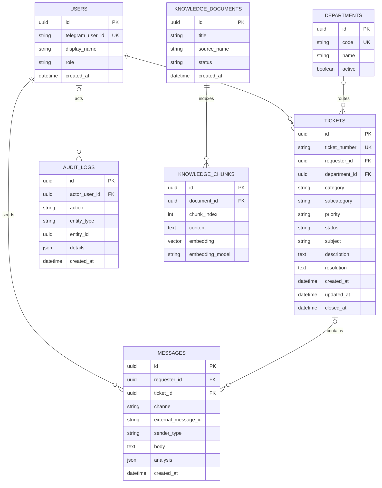

# AI Service Desk MVP: architecture and implementation plan

## Status

The MVP, Agent/Admin panel baseline, and Telegram reply notification behavior are approved. The application persists Telegram delivery outcomes. Deployment remains restricted to HTTPS and a trusted-network ingress.

## Architecture

### Components

- **FastAPI** exposes the ticket, knowledge, AI, health, Telegram webhook, internal workflow APIs, and a same-origin server-rendered Agent/Admin panel.
- **Jinja2 and HTMX** render panel pages and partial updates. UI handlers perform server-side role checks and reuse application behavior; the browser never receives or uses an API Bearer token.
- **PostgreSQL with pgvector** stores users, departments, tickets, messages, audit events, knowledge documents/chunks, and embeddings.
- **Gemini API** classifies requests, generates grounded answers, and creates query/document embeddings.
- **Telegram Bot API** delivers incoming user messages and outgoing replies.
- **n8n** is an optional Telegram processing trigger. When configured, it calls the authenticated internal processing endpoint; otherwise FastAPI processes the message directly.
- **Docker Compose** runs PostgreSQL, migrations, API, and optional n8n. Alembic is the only schema migration mechanism.

### Request flows

**Telegram:** Telegram HTTPS webhook -> secret validation and request validation -> persist incoming message under a unique `(channel, external_message_id)` -> optional n8n trigger or direct FastAPI processing -> Gemini classification -> pgvector retrieval -> grounded response or ticket escalation -> persist outcome -> send Telegram reply.

**Agent API:** Bearer role token -> FastAPI role check -> ticket/knowledge/analytics service -> PostgreSQL. User operations additionally scope ticket access to the supplied Telegram user ID; this ID is not independently verified and therefore is not an identity proof.

**Agent/Admin panel:** `GET /ui/login` issues a short-lived signed pre-auth CSRF challenge -> HTTPS login form submits the challenge and existing role token -> server validates and discards the role token -> signed session cookie containing only role, CSRF token, and expiry -> server-rendered UI routes -> shared ticket/message/knowledge behavior. Require `HttpOnly`, `Secure`, `SameSite=Lax`, an 8-hour expiry, a mandatory `SESSION_SIGNING_SECRET` with no fallback, and CSRF validation on every state-changing UI form, including login and logout. Logout clears the cookie; rotating the signing secret invalidates all sessions. The stateless design cannot revoke an individual session before expiry. The browser never receives or persists the role token.

**Panel reply notification:** after a panel reply is persisted, locate the private Telegram chat ID from an inbound Telegram `Message` linked to the ticket -> if the ticket is eligible and `TELEGRAM_TOKEN` is configured, call `sendMessage` once with the complete plain-text reply -> persist the delivery outcome -> redirect and show saved and delivery status separately. The client cannot supply or override the recipient.

**Knowledge ingestion:** Admin uploads PDF/TXT/Markdown -> validate extension and 10 MB limit -> extract text -> split into overlapping chunks -> generate Gemini embeddings -> store document and chunks in one database transaction. A failed indexing attempt must not leave a document marked indexed.

### Telegram requester notification after a panel reply

**Status:** approved behavior; implementation pending.

Agent/Admin submits the existing panel reply form -> persist the agent message -> if the ticket is eligible and `TELEGRAM_TOKEN` is configured, call Telegram `sendMessage` once with the persisted reply text -> record the delivery outcome -> redirect to the ticket and show save and delivery results separately. Never let a Telegram failure imply that a persisted reply was lost, and do not report delivery unless Bot API returns `ok=true`. Do not automatically retry after timeout or ambiguous results.

**Approved ERD delta, pending migration:**

- Add nullable `MESSAGES.telegram_chat_id` to persist `message.chat.id` only for an inbound Telegram private-chat update. The source message's `ticket_id` associates the address with its ticket; no recipient column is needed on `TICKETS`. Group and other chat types remain ineligible.
- Add nullable `MESSAGES.telegram_delivery_status` and `telegram_delivery_updated_at` for Agent/Admin panel replies. Use `pending`, `accepted`, `not_configured`, `not_applicable`, and `unconfirmed`. `accepted` means Telegram Bot API returned `ok=true`, not that the user read the message.
- Add these fields using an additive Alembic migration. Existing messages remain null; do not backfill `telegram_chat_id` from `telegram_user_id`. Retention deletes the address together with its message/ticket.
- Keep delivery status and chat IDs out of public REST schemas; they are internal panel/integration data.

**Approved side-effect and failure semantics:**

- Persist the message before contacting Telegram. A DB/validation failure must never send a Telegram message.
- For an eligible Telegram ticket, reject replies longer than 4,000 characters before saving. Send the entire saved reply as plain text; do not truncate or split it.
- A missing target or missing `TELEGRAM_TOKEN` must leave the saved reply intact and be shown as not applicable/not configured.
- Telegram rejection, timeout, malformed response, or a failure to persist the post-send status must not be shown as confirmed delivery. A status may remain `pending` if the external call succeeds but the status update fails.
- Do not return a retriable error after the reply has already been saved solely because Telegram delivery failed; show the outcome after redirect to avoid accidental duplicate replies. Automatic retries and outbox are out of scope.
- Never pass the bot token to the browser or log it, the full reply body, or sensitive Telegram response details. Send plain text only unless formatting is separately approved.

The sender lookup uses the earliest eligible inbound Telegram message linked to the ticket. New non-private updates do not receive a stored notification target. Existing tickets without a stored private-chat ID remain ineligible. The chat association follows the existing 365-day ticket retention policy; no additional consent flow is added.

### Data model (ERD)

`closed_at` is implemented in the current model and by Alembic revision `0003_ticket_closed_at`. The panel's stateless signed cookie does not require a session table or database migration. The audit entity reference remains polymorphic, as in the current schema; shared role tokens do not provide individual staff attribution.

The approved notification ERD delta is not implemented yet: an additive migration must add nullable `messages.telegram_chat_id`, `messages.telegram_delivery_status`, and `messages.telegram_delivery_updated_at`. The inbound message with the chat ID is linked to its ticket; no address is backfilled for existing messages.

### Security and operational boundaries

- The three static Bearer tokens map to User, Agent, and Admin. Secrets are supplied through environment configuration and must not be logged.
- User API bearer tokens are bound to individual Telegram IDs via USER_API_TOKENS. The requested X-Telegram-User-ID must match the token binding.
- Telegram webhook and n8n internal processing use separate shared secrets; missing secrets fail closed.
- The webhook commits the incoming message and its processing schedule before acknowledging it. The background worker retries failed n8n calls.
- The Compose API binding is localhost-only. Receiving Telegram webhooks requires an operator-provided public HTTPS ingress/reverse proxy; this repo does not yet configure one.
- Panel deployment must remain behind HTTPS and a trusted-network allowlist at ingress/firewall. Compose does not configure or enforce this panel ingress boundary.
- Panel HTML responses are `no-store`. Upload routes require a bounded `Content-Length` and reject multipart request bodies above the 10 MB file limit plus bounded form overhead before parsing/spooling.
- Shared Agent/Admin tokens authorize by role only; they do not establish an individual employee identity. Do not record a staff identity in audit events unless a separate verified identity mechanism is approved.
- Request text and knowledge excerpts are untrusted model input. The model may only offer source-grounded instructions and may not claim privileged actions were performed.
- Message processing locks the database row while processing a message, serializing concurrent processing of that row. The processing schedule survives restarts. Automatic delivery records an unconfirmed attempt before calling Telegram. Reprocessing skips both confirmed and unconfirmed attempts. An interrupted attempt can leave the delivery outcome unknown.
- Notification recipients come only from the persisted `message.chat.id` on an eligible private-chat inbound message linked to the ticket; never accept a recipient from panel input or fall back to `telegram_user_id`.
- Panel notification failures are distinct from message-save failures. Once a reply is committed, do not return a post-save 5xx for Telegram failure; display the saved reply and unconfirmed delivery separately.

### Data retention

Implement a daily idempotent cleanup command, invoked by the deployment's scheduler:

- Delete tickets in `closed` status whose `closed_at` is older than 365 days, together with their related messages.
- On transition to `closed`, set `closed_at`; when reopened, clear it; when closed again, set a new timestamp.
- Delete knowledge documents older than 365 days and rely on the existing document-to-chunk cascade.
- Delete audit records older than 365 days.
- Delete unattached Telegram messages older than 365 days. Attached messages follow the ticket's retention lifetime.
- Do not automatically delete open tickets.
- Use bounded batches and a transaction per batch; log counts, and make retries safe.

The host/operator must configure and monitor the daily schedule. Cleanup must support a dry-run mode for initial verification and must never delete open tickets.

## Implementation plan

Steps 1–6 describe the already implemented MVP baseline and are retained for context. The panel work is step 7; production changes for it start only after the user explicitly approves this architecture and `openapi.yaml`.

1. **API contracts and schemas**
   - Add strict request validation for ticket updates (reject unknown fields, empty patches, and invalid nulls).
   - Add typed message output and `GET /api/v1/tickets/{ticket_id}/messages`, applying ticket ownership checks to User.
   - Keep existing role/token model and document the pilot network trust boundary.
   - Add audit actor attribution only if it can be represented safely with the current static-token design; otherwise retain null and document its limitation.
   - Acceptance: API tests cover each role, ownership, missing ticket, message ordering, invalid PATCH, and no mutation after rejected input.

2. **Ticket routing and workflow correctness**
   - Preserve current route table and RAG thresholds unless the user approves changes.
   - Make fallback/error escalation explicit and ensure a failed database write never returns a success-shaped ticket confirmation.
   - Prevent repeat processing from creating duplicate tickets within the single-instance MVP assumptions; document remaining concurrency limits.
   - Acceptance: tests cover each route, fallback route, autonomous answer, each escalation cause, AI failure, duplicate update, and repeated processing.

3. **Knowledge ingestion and RAG**
   - Preserve PDF/TXT/Markdown and 10 MB limit; verify chunking, extraction errors, embedding model filtering, and transaction rollback.
   - Acceptance: focused tests cover file type/size/empty text, indexing success/failure, retrieval filtering, citations, and no-answer escalation.

4. **Retention**
   - Add the `closed_at` migration and status transition behavior.
   - Implement a dry-run-capable, bounded, idempotent cleanup command and document daily scheduling.
   - Acceptance: tests prove 365-day cutoff, reopened-ticket cutoff reset, related-message deletion, chunk cascade, audit expiry, and open-ticket preservation.

5. **Telegram, n8n, and runtime**
   - Validate webhook payload shapes and secret handling; exercise direct and n8n paths and external-service errors.
   - Review Compose startup/migration/health-check behavior and document HTTPS ingress prerequisites without exposing API or n8n editor publicly by default.
   - Acceptance: tests cover invalid secret, malformed update, repeated update, n8n error, Telegram send error, and successful direct/workflow processing.

6. **Verification and documentation**
   - Run unit tests and PostgreSQL API integration tests against the isolated `TEST_DATABASE_URL`; do not run destructive migrations against any non-test database.
   - Run the documented Compose startup and migration path only in a disposable local environment with explicit credentials.
   - Update README to reflect actual implemented scope, limitations, retention scheduling, and tested commands.
   - Acceptance: report exact commands/results; tests requiring live Gemini/Telegram/n8n must be clearly separated from mocked tests.

7. **Agent/Admin panel (approved)**
   - Add Jinja2 and same-origin server-rendered UI routes for login/logout, ticket queue/detail/message/update, and Admin-only knowledge list/upload. Serve a pinned local HTMX asset (no CDN). Keep queue search limited to the latest 100 API results; do not introduce new search, pagination, assignment, or SLA APIs.
   - Add required `SESSION_SIGNING_SECRET` configuration without a fallback; validate role tokens only on the server and issue a signed 8-hour cookie containing no Bearer token. Configure `HttpOnly`, `Secure`, and `SameSite=Lax`; require synchronizer CSRF tokens on all state-changing forms. Enforce HTTPS and trusted-network access at ingress.
   - Reuse existing validation and business behavior. Do not expose API tokens in HTML, JavaScript, URLs, browser storage, or logs. Enforce Admin-only document operations on the server.
   - Add focused tests for login role mapping, cookie flags/expiry/logout, invalid credentials, CSRF rejection, Agent/Admin permissions, ticket/message flows, upload body/file limits and errors, and backend unavailability; update README/operator guidance.
   - Acceptance: the browser has no API token; invalid role/CSRF requests cannot mutate data; Agent cannot use knowledge-management UI routes; Admin can list/upload within existing limits; queue search clearly reports the 100-result bound.

8. **Telegram notification for panel replies (approved; implementation pending)**
   - Add nullable `Message.telegram_chat_id`, `telegram_delivery_status`, and `telegram_delivery_updated_at` with an additive Alembic migration. Store `message.chat.id` from validated private-chat Telegram updates; existing messages remain without an address.
   - Only replies posted by Agent/Admin through the panel are eligible. Resolve the recipient from an inbound Telegram message linked to the ticket; do not use a client-supplied recipient or `telegram_user_id` fallback.
   - Reject eligible replies longer than 4,000 characters before saving. Otherwise persist first, attempt one `sendMessage` with the full plain-text body, store the outcome, and show message-save and delivery results separately. No automatic retries or outbox.
   - Acceptance: tests cover private vs non-private update handling, exact chat targeting for Agent/Admin, no fallback for old tickets, length 4,000/4,001 boundary, no send when message persistence fails, and correct UI/database outcomes for missing token, Bot API rejection, timeout, malformed response, and status-write failure.

## Decisions already provided by the user

- Goal: a ready MVP within the current README scope.
- Gemini is a test API and may receive request/document content for this MVP.
- Data retention period is at the assistant's discretion; this draft selects 365 days as defined above.

## Approved panel decisions

The user approved the panel scope, stateless signed 8-hour Agent/Admin session, mandatory signing secret, CSRF, logout/key rotation behavior, trusted-network/HTTPS boundary, database-backed panel search with 25 tickets per page, existing status/priority values, Admin-only knowledge list/upload, and shared-token audit attribution limitation. Configure the actual network ingress before exposing the service beyond loopback.

The approved Agent/Admin panel baseline requires no schema migration; configure the documented signing secret and trusted HTTPS ingress before deployment beyond loopback. The approved Telegram notification feature requires the additional additive migration described above.
